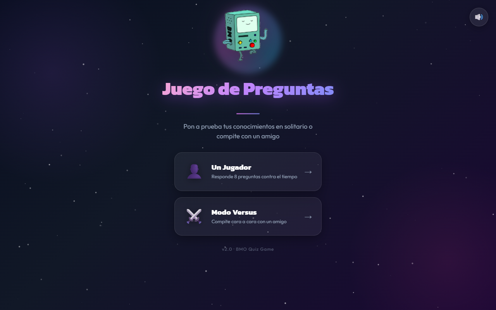
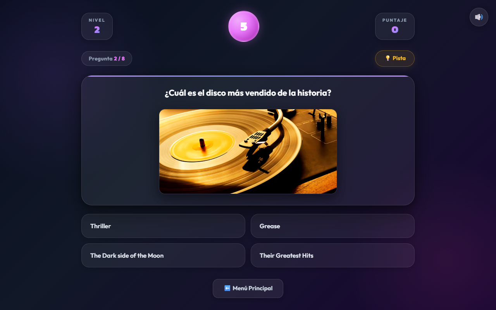
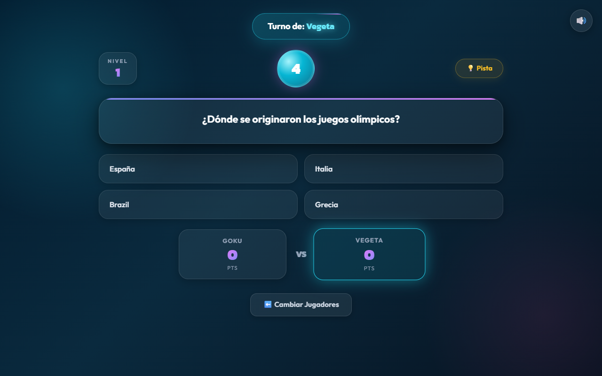
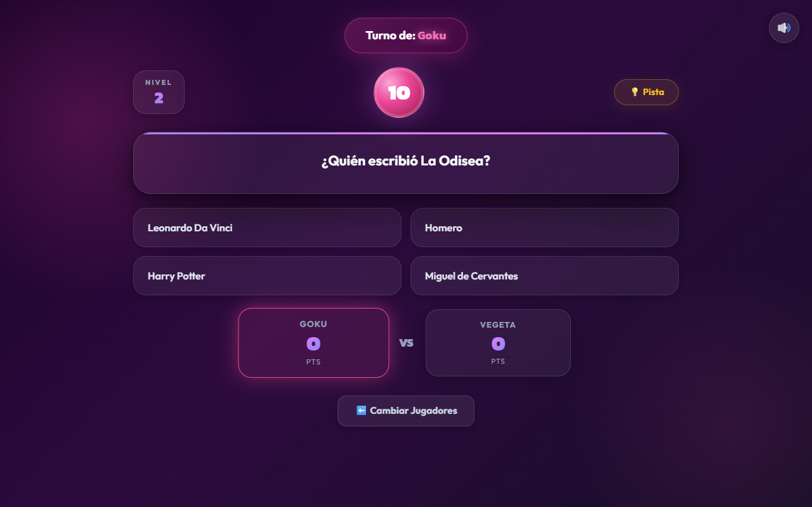
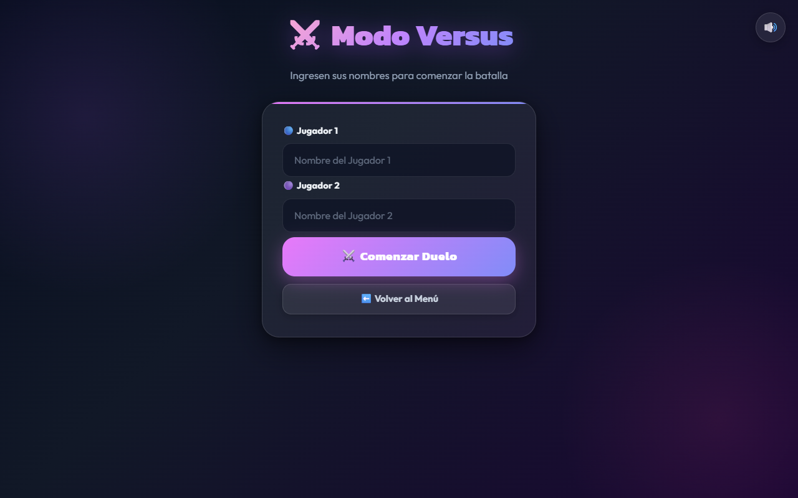

# 🎮 Juego de Preguntas

Un juego de trivia interactivo con dos modos de juego, temporizador, pistas y diseño arcade neon. Construido con HTML, CSS y JavaScript puro.

---

## ✨ Características

- 🧠 **Banco de preguntas** con múltiples niveles de dificultad
- ⏱️ **Temporizador de 10 segundos** por pregunta con alerta visual en los últimos 3 segundos
- 💡 **Sistema de pistas** con imagen y descripción
- 👤 **Modo Un Jugador** — 8 preguntas contra el reloj con puntaje final
- ⚔️ **Modo Versus** — 2 jugadores se turnan con marcador en tiempo real
- 🎨 **Diferenciador visual por jugador** — fondo fucsia para J1, cyan para J2
- 🔊 **Música de fondo y efectos de sonido** con botón de silencio
- 📱 **Diseño totalmente responsivo** para móvil, tablet y escritorio
- 🖼️ **Carga inteligente de imágenes** — se ocultan si la URL externa falla

---

## 🖼️ Capturas de Pantalla

### Menú Principal


### Modo Un Jugador


### Modo Versus — Turno Jugador 1 (fucsia)


### Modo Versus — Turno Jugador 2 (cyan)


### Registro de Jugadores (Modo Versus)


---

## 🚀 Cómo jugar

1. Abre `index.html` en tu navegador — te llevará automáticamente al **Menú Principal**
2. Elige tu modo:
   - **👤 Un Jugador**: responde 8 preguntas lo más rápido posible
   - **⚔️ Modo Versus**: ingresa los nombres de ambos jugadores y compite por turnos
3. Selecciona una respuesta antes de que el temporizador llegue a 0
4. Usa 💡 **Pista** si necesitas ayuda
5. Al finalizar puedes volver al menú o jugar de nuevo

---

## 🗂️ Estructura del Proyecto

```
Juego-de-preguntas/
├── index.html           → Entrada (redirige al menú principal)
├── pagPrincipal.html    → Menú Principal
├── indexJP.html         → Juego Un Jugador
├── versus.html          → Juego Modo Versus
├── nombreVersus.html    → Registro de nombres (Versus)
├── estiloJP.css         → Estilos globales (diseño responsivo)
├── index.js             → Lógica del Modo Versus
├── indexJP.js           → Lógica del Modo Un Jugador
├── capturarNombres.js   → Captura de nombres para Versus
├── basePreguntas.js     → Banco de preguntas (niveles 1-3)
├── soundManager.js      → Gestor de audio (música + efectos)
├── julia-133094.mp3     → Música del menú
├── sonidoTension.mp3    → Música del juego
├── sonido.mp3           → Efecto de click
└── imagenes/            → Imágenes y assets del juego
```

---

## 🛠️ Tecnologías

| Tecnología | Uso |
|---|---|
| HTML5 | Estructura y semántica |
| CSS3 | Glassmorphism, animaciones, responsive |
| JavaScript ES6+ | Lógica del juego, temporizador, DOM |
| [SweetAlert2](https://sweetalert2.github.io/) | Modales de respuesta/puntaje |
| Google Fonts | Tipografías Outfit + Kanit |

---

## 🎨 Diseño

- Fondo oscuro con gradiente púrpura profundo
- Componentes con efecto **glassmorphism** (backdrop-filter blur)
- Animaciones de entrada `fadeInUp` en cada pantalla
- Countdown circular con **glow pulsante**
- Botones con **efecto shimmer** en hover
- **Transición de tema por jugador** en Modo Versus:
  - 🟣 Jugador 1 → tema fucsia/rosa
  - 🔵 Jugador 2 → tema cyan/azul

---

## 📋 Bugs corregidos (v2.0)

- ✅ El temporizador ya no dispara múltiples veces al llegar a 0
- ✅ Doble-click en respuesta ya no procesa la misma dos veces (`procesandoRespuesta` flag)
- ✅ Imágenes externas rotas se ocultan silenciosamente (sin fallback a BMO)
- ✅ Al terminar el juego se puede elegir entre **Jugar de nuevo** o **Menú Principal**
- ✅ `index.html` ahora redirige automáticamente al Menú Principal

---

## 👤 Autor

**JAPREZ** · [GitHub](https://github.com/JAPREZ/Juego-de-preguntas)
